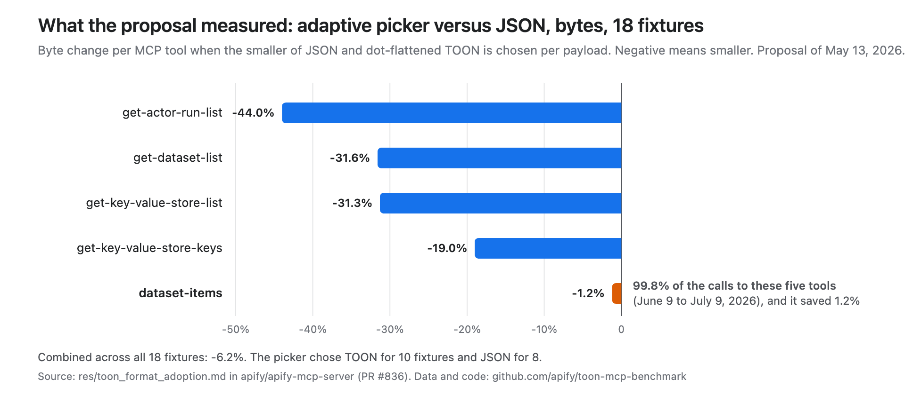
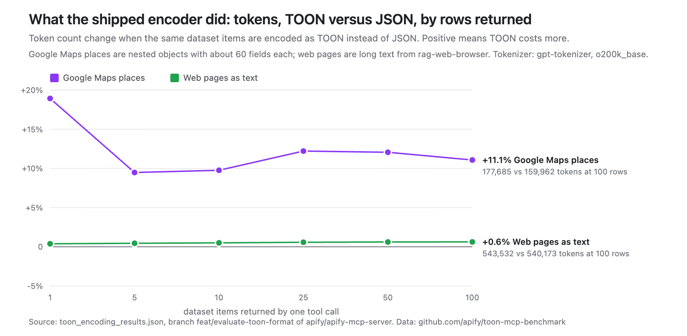
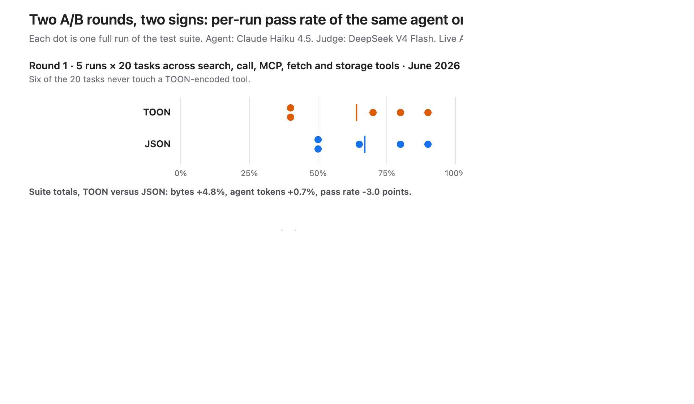

# TOON in the Apify MCP Server: the evaluation data

Raw artifacts, parsed CSVs, and chart code from Apify's May–July 2026 evaluation of
[TOON](https://github.com/toon-format/toon) (Token-Oriented Object Notation) as the text encoding for
list-style tool results in the [Apify MCP Server](https://github.com/apify/apify-mcp-server).
TOON was released on June 9, 2026 and removed on July 9, 2026. This repository is the evidence behind the write-up.

**Headline result:** on real scraped payloads, TOON produced no consistent change in bytes, tokens, or task accuracy.
Two live A/B rounds disagreed in sign on every headline metric. On the highest-traffic tool (dataset items) the
proposal's own fixture study projected a 1.2% byte saving, and the production encoder measured 9.5 to 18.9% *more*
tokens on nested Google Maps data.

## What is here

| Path | Contents |
|---|---|
| `data/raw/` | Byte-identical copies of the upstream artifacts (spec, eval harness code, run log, result JSON, test cases). `MANIFEST.txt` maps each file to its upstream commit, path, git blob id, and SHA-256. |
| `data/PROVENANCE.md` | Where each file came from, what each measurement is, and the caveats that travel with the data. Read this before quoting anything. |
| `data/parse.py` | Turns the raw files into the CSVs below. Deterministic; re-run with `python3 data/parse.py`. |
| `data/spec-fixtures.csv` | The proposal's per-tool byte savings (18 fixtures, adaptive picker). |
| `data/encoder-rows.csv`, `data/encoder-sweeps.csv` | Encoder-only measurement of the production encoder: bytes and `o200k_base` tokens, TOON vs JSON, by row count. |
| `data/execution-a.csv`, `data/execution-a-runs.csv` | Live A/B round 1: 5 runs × 2 formats × 20 tasks, per-task bytes, tokens, verdict. |
| `data/execution-b.csv`, `data/execution-b-runs.csv` | Live A/B round 2: 3 runs × 2 formats × 16 storage tasks, with prompt/completion token split, turns, duration. |
| `charts/make_charts.py` | Generates the three figures (SVG) from the CSVs. `charts/*.png` are renders of the same SVGs. |

## The three measurements, in one table

| Measurement | What it compares | Metric | Result (TOON vs JSON) |
|---|---|---|---|
| Proposal fixtures (May 2026) | min(JSON, TOON-flatten) vs JSON on 18 captured payloads | UTF-8 bytes | list tools −19 to −44%; dataset items −1.2%; all 18 combined −6.2% |
| Encoder-only (June 2026) | production `encodeToon` (always TOON, dot-flatten, markdown fence) vs `JSON.stringify` | bytes and `o200k_base` tokens | Google Maps places +9.5 to +18.9% tokens; web-page text +0.4 to +0.6%; 10 Actor runs +9.5%; 4 KV keys −5.9% |
| A/B round 1 (June 2026) | same agent, 20 tasks × 5 runs per format | tool-result bytes, agent tokens, LLM-judged pass rate | bytes +4.8%, tokens +0.7%, pass 64% vs 67% (per-run passes 8–18 of 20) |
| A/B round 2 (June 2026) | same agent, 16 storage tasks × 3 runs per format, after "request only the fields you need" tool descriptions | same | bytes −1.4%, tokens −1.7%, pass 92% vs 88% |

Agent under test: `anthropic/claude-haiku-4.5`. Judge: `deepseek/deepseek-v4-flash`. Encoder-only tokens are a GPT-4o tokenizer proxy;
A/B tokens are the agent conversation's reported usage. Details and caveats: `data/PROVENANCE.md`.

## Figures





## Reproduce

```bash
python3 data/parse.py          # raw -> CSV, prints sanity aggregates against the committed summaries
python3 charts/make_charts.py  # CSV -> charts/fig*.svg
```

The encoder-only measurement itself cannot be re-run: `toon_encoding_measure.ts` reads fixture files that were never committed upstream.
The results JSON is the only record. The A/B harness (`toon_ab_eval.ts`) needs a checkout of the upstream repository at the recorded commit,
an Apify token, and an OpenRouter key, and live Actor output varies between runs, so exact per-run numbers will not reproduce.

## Known limitations

- Two A/B executions, different suites, opposite signs. Quote them separately, never averaged.
- Pass/fail is an LLM judge's verdict; per-run pass counts in round 1 swing between 8 and 18 of 20.
- Six of the 20 round-1 tasks never call a TOON-encoded tool.
- Failure causes were not recorded. One task (`instagram-posts`) passed 1 of 5 runs under TOON and 5 of 5 under JSON; the logs cannot say why.
- Encoder-only tokens use `o200k_base`, not the agent's tokenizer.

## License

Code: MIT (`LICENSE`). Data under `data/`: CC BY 4.0 (`LICENSE-DATA`).

## Citation

> Apify (2026). *TOON in the Apify MCP Server: evaluation data.* https://github.com/apify/toon-mcp-benchmark. Underlying artifacts from apify/apify-mcp-server, commits 78e5bb5f and 9417a220.
